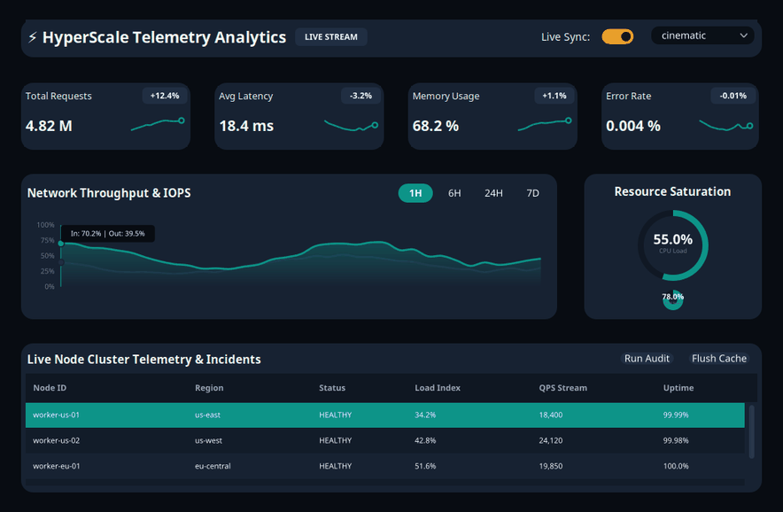
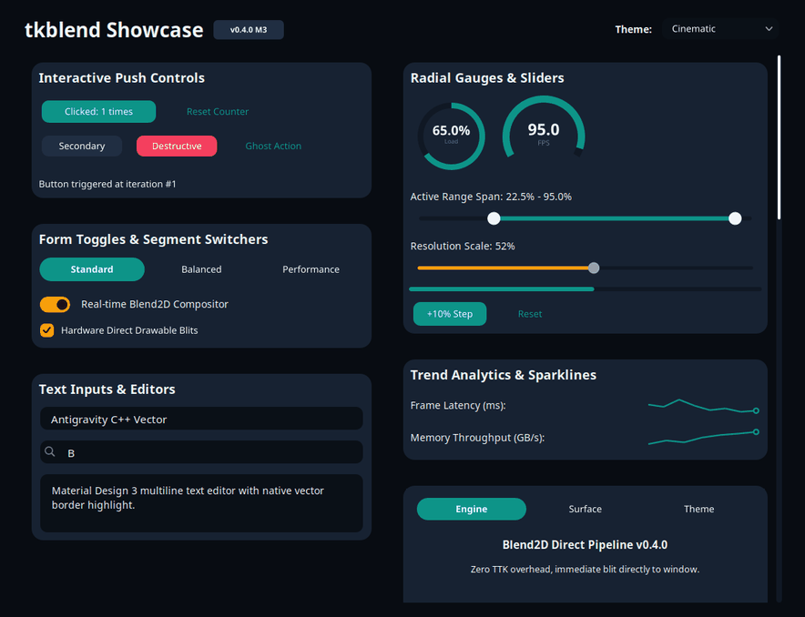
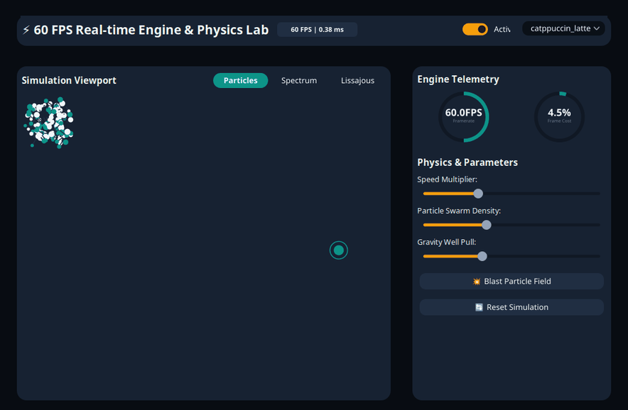
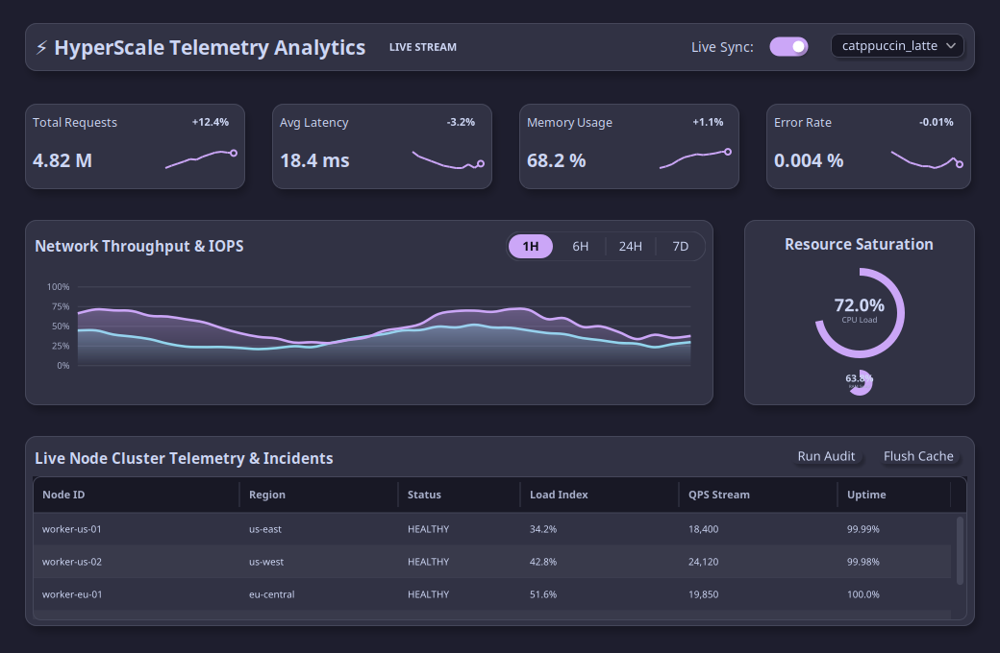
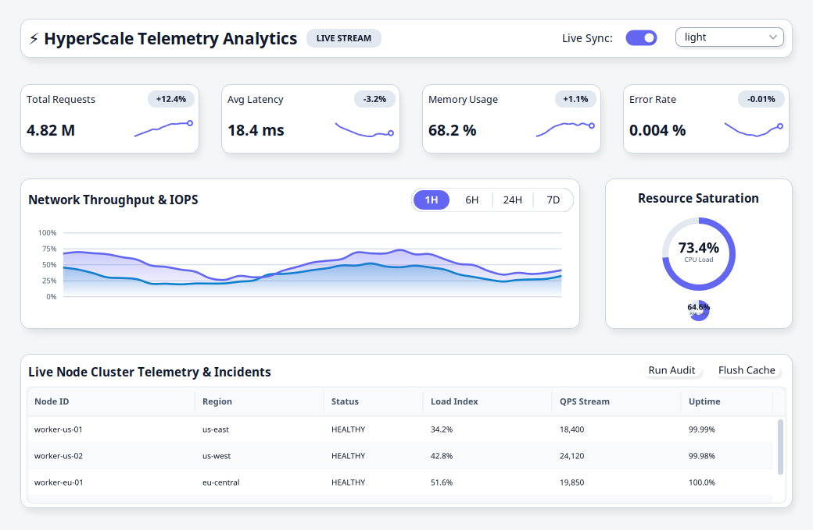
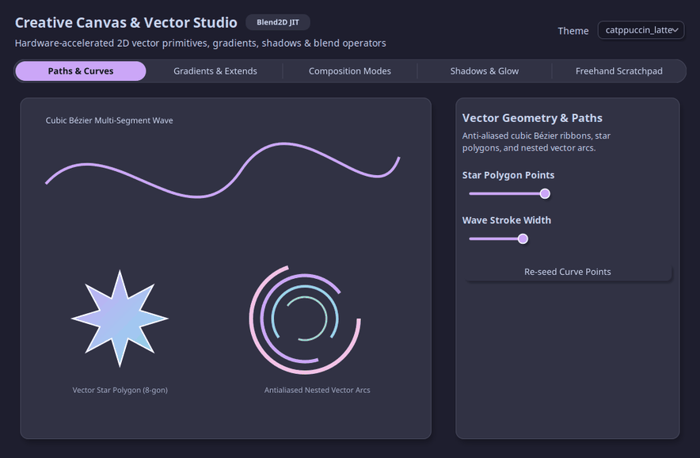
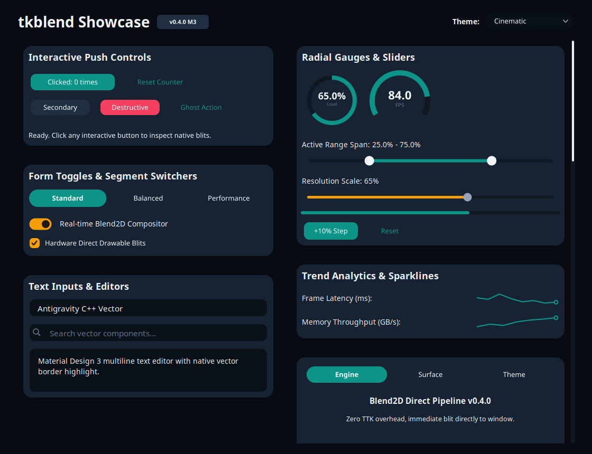

<div align="center">

# tkblend

### 2D Vector UI and Graphics Library for Tkinter
**Blend2D Rasterization with Native C++ Window Blitting**

[](https://python.org)
[](https://blend2d.com)
[](#status-trade-offs--current-limitations)
[](LICENSE)

<br/>

<p align="center">
  
</p>

*Telemetry displays, Bézier curve plotting, radial gauges, and theme switching rendered via Blend2D in Python Tkinter.*

</div>

> [!NOTE]
> **tkblend** is an experimental project exploring 2D vector graphics rendering and custom UI components for Python Tkinter using Blend2D. It bypasses the standard TTK styling engine by rendering custom controls into memory buffers and transferring them directly to Tk drawables. The codebase is under active development.

---

## Overview

**tkblend** connects the **Blend2D** 2D vector rasterization engine with **Python Tkinter**. By rendering directly into native memory buffers and transferring pixel data to Tk window drawables (or `Tk_PhotoPutBlock`), it provides antialiased vector drawing, gradient fills, and soft shadows without requiring intermediate PIL/Pillow image conversions or external GUI web runtimes.

The library includes:
* A standalone suite of vector widgets (`Button`, `Card`, `Slider`, `RangeSlider`, `Switch`, `Checkbox`, `Radio`, `Progressbar`, `CircularProgress`, `SegmentedButton`, `Entry`, `SearchEntry`, `TextBox`, `ComboBox`, `Table`, `Badge`, `Label`, `ScrollableFrame`, `Tabview`, `Sparkline`).
* An immediate-mode canvas (`NativeBlitCanvas`) for custom rendering loops and animations.
* Built-in CSS-inspired theme palettes with runtime switching.
* High-DPI coordinate scaling support (`ScalingTracker`).

---

## Documentation

Comprehensive guides are available in the [`docs/`](docs/README.md) directory:

| Guide | Description |
| :--- | :--- |
| **[Getting Started](docs/getting_started.md)** | Installation, prerequisites, build steps, DPI scaling, and a first example application. |
| **[Architecture & Rendering Pipeline](docs/architecture.md)** | C++ blit pipeline, `Tk_PhotoPutBlock`, transparent frame handling, GIL management, and memory safety. |
| **[Widget Catalog](docs/widgets.md)** | Catalog of built-in vector widgets with properties, methods, and code examples. |
| **[Theming Engine & Palettes](docs/theming.md)** | Runtime theme switching, built-in presets, palette tokens, and background cascading. |
| **[Canvas & Custom Vector Drawing](docs/canvas_and_vector.md)** | `NativeBlitCanvas`, paths, gradients, shadows, `DrawBatch`, and custom `BaseControl` authoring. |
| **[Caveats, Edge Cases & Troubleshooting](docs/caveats_and_edge_cases.md)** | Platform differences, thread safety, font shaping, and widget layout gotchas with workarounds. |
| **[Examples Guide](docs/examples.md)** | Walkthroughs and instructions for running the included sample applications. |

---

## Core Capabilities

### 1. Direct Buffer Transfer
Pixel buffers are rendered in memory by Blend2D and transferred directly to Tkinter display surfaces via native drawables or `Tk_PhotoPutBlock`.
* **No intermediate PIL conversions**: Avoids per-frame allocations and format translation between PIL and Tk images.
* **C++ rasterization**: Vector path rasterization and color math execute in compiled C++ routines.

### 2. Standalone Vector Widgets

<p align="center">
  
</p>

A collection of custom-drawn widgets that operate independently of TTK themes:
* **Controls**: `Button` (Primary, Secondary, Success, Danger, Outline), `Switch`, `Checkbox`, `Radio`, `SegmentedButton`.
* **Sliders & Gauges**: `Slider` (single handle), `RangeSlider` (dual handle), `Progressbar`, `CircularProgress`.
* **Containers**: `Card` (with box-blur soft shadows), `Frame`, `ScrollableFrame`, `Tabview`.
* **Text & Inputs**: `Entry`, `SearchEntry`, `TextBox`, `ComboBox` / `OptionMenu`.
* **Data Presentation**: `Table` (antialiased text, sortable columns, virtualized rows), `Badge`, `Label`, `Sparkline`.

### 3. Immediate-Mode Canvas (`NativeBlitCanvas`)

<p align="center">
  
</p>

An immediate-mode vector drawing widget for animations, charts, and visualizations:
* **Callback-based painting**: Provide an `on_paint(s: Surface)` callback called on resize or scheduled redraws.
* **Standard Tkinter geometry**: Embeds like any Tk widget using `pack()`, `grid()`, or `place()`.

### 4. Dynamic Theming

<p align="center">
  
  
</p>

* **Runtime switching**: Change themes dynamically via `set_theme("catppuccin_mocha")`, `set_theme("cinematic")`, or `set_theme("light")`.
* **Built-in presets**: Includes `dark`, `light`, `catppuccin_mocha`, `catppuccin_latte`, `cinematic`, `tokyo_night`, `cyberpunk`, `dracula`, `emerald_forest`, `nord`, `sunset_amber`, `monokai_pro`, `solarized_dark`, `solarized_light`, `ocean`, and `slate`.
* **Background inheritance**: Container widgets cascade their background color tokens down to child controls.

### 5. Custom Control Authoring

<p align="center">
  
</p>

Create custom vector controls by subclassing `BaseControl`:
* **Vector primitives**: Cubic and quadratic Bézier curves, arcs, rounded rectangles, and polygons.
* **Shaders**: Multi-stop linear and radial gradients with `PAD`, `REPEAT`, and `REFLECT` extend modes.
* **Shadows**: Multi-pass box-blur drop shadows with configurable blur radius, spread, and opacity.
* **Compositing**: Standard Porter-Duff blend modes (`SRC_OVER`, `MULTIPLY`, `SCREEN`, `ADD`, etc.).

### 6. High-DPI Scaling Support
* `ScalingTracker` queries display scaling on Windows, macOS, and Linux to calculate logical-to-physical coordinate ratios.
* Widget dimensions, corner radii, and stroke widths adjust according to the active scale factor.

### 7. CustomTkinter Integration Bridge (`tkblend.ctk`)
* Provides an optional bridge to draw CustomTkinter canvas elements using Blend2D for smoother antialiasing.

---

## Status, Trade-offs & Current Limitations

As an experimental library, `tkblend` has specific design trade-offs:

1. **Compilation & Native Dependencies**: Building `tkblend` requires a C++17/20 compiler, CMake, nanobind, Blend2D source files/submodules, and Tcl/Tk development headers. Pre-built binary wheels are not yet distributed on PyPI.
2. **Single-Threaded Tkinter Event Loop**: Although Blend2D rasterization executes in C++ and can release the GIL during heavy math, all Tkinter widget interactions, event dispatching, and window management remain on Python's main UI thread.
3. **Platform-Specific Blitting**: Direct window drawable blitting uses native platform APIs (X11 `XPutImage` on Linux, Win32 `BitBlt`/`SetDIBitsToDevice` on Windows, Cocoa on macOS). When native drawables are unavailable, rendering falls back to Tkinter's `Tk_PhotoPutBlock` image path.
4. **Text Rendering**: Text is rendered through Blend2D's font engine. Complex multi-line formatting, bidirectional text, and font fallbacks are simpler than dedicated text layout engines (e.g. HarfBuzz/Pango).
5. **Widget Scope**: Built-in widgets are lightweight vector controls designed for standard interface tasks; they are not intended to replace full-featured native OS accessibility trees or advanced multi-line document processors.

---

## Performance Considerations

* **Eliminating Pillow Overhead**: Traditional Tkinter drawing with Pillow requires rasterizing into a Python PIL Image, converting pixel formats to RGBA/Tk photo format, and copying into a `PhotoImage`. `tkblend` renders directly into a shared C++ memory buffer, reducing allocation overhead.
* **Rasterization Cost**: Blend2D utilizes JIT SIMD compilation (via AsmJit) for 2D primitives. However, total frame rendering time remains proportional to the number of drawing operations, shadow blur radii, and surface resolution.
* **Redraw Coalescing**: Widgets use Tkinter's `after_idle` scheduling to coalesce repeated state updates (such as rapid mouse movement) into a single repaint pass per frame.

---

## Quick Start: Vector Widgets

```python
import tkinter as tk
from tkblend import (
    Card,
    Button,
    Slider,
    Switch,
    Progressbar,
    CircularProgress,
    Badge,
    set_theme,
    get_theme,
)

root = tk.Tk()
root.title("tkblend Vector UI")
root.geometry("460x580")
root.configure(bg="#181825")

set_theme("catppuccin_mocha")

# Container card with drop shadow
card = Card(root, width=400, height=520)
card.pack(padx=20, pady=20, fill="both", expand=True)

# Status badge
badge = Badge(card.content, text="Blend2D Vector Widget", variant="primary")
badge.pack(pady=8)

# Radial gauge & linear progress bar
gauge = CircularProgress(card.content, size=110, value=75.0, unit="%")
gauge.pack(pady=10)

pbar = Progressbar(card.content, width=280, value=75.0)
pbar.pack(pady=8)

# Slider controlling indicators
def on_slider(val):
    gauge.set_value(val)
    pbar.set(val)

slider = Slider(card.content, width=280, value=75.0, command=on_slider)
slider.pack(pady=8)

# Toggle switch
switch = Switch(card.content, text="Enable Feature", is_checked=True)
switch.pack(pady=10)

# Theme toggle button
is_dark = True
def toggle_theme():
    global is_dark
    is_dark = not is_dark
    set_theme("catppuccin_mocha" if is_dark else "light")
    root.configure(bg=get_theme().bg)

btn = Button(
    card.content,
    text="Toggle Dark / Light Theme",
    variant="primary",
    command=toggle_theme,
)
btn.pack(pady=8)

root.mainloop()
```

---

## Quick Start: Immediate-Mode Canvas

```python
import tkinter as tk
from tkblend import NativeBlitCanvas, Surface, LinearGradient

root = tk.Tk()
root.title("tkblend Canvas")
root.geometry("640x420")

def on_draw(s: Surface):
    w, h = s.width, s.height
    s.clear("#11111b")
    
    # Rounded card background with drop shadow
    s.draw_card(24, 24, w - 48, h - 48, rx=16, ry=16, bg_color="#181825", shadow_blur=16.0)
    
    # Linear gradient fill
    grad = LinearGradient(48, 0, w - 48, 0)
    grad.add_stop(0.0, "#89b4fa").add_stop(0.5, "#cba6f7").add_stop(1.0, "#a6e3a1")
    
    # Vector text and progress track
    s.draw_text("Blend2D Vector Canvas", 48, 70, font_size=16, color="#cdd6f4")
    s.fill_rounded_rect(48, 100, w - 96, 10, 5, 5, grad)

canvas = NativeBlitCanvas(root, width=640, height=420, on_paint=on_draw)
canvas.pack(fill="both", expand=True)

root.mainloop()
```

---

## Interactive Examples

The `examples/` directory contains sample scripts demonstrating component usage:

```bash
# Master Widget Showcase
uv run python examples/showcase.py
```

<p align="center">
  
</p>

### Available Examples

* **[Master Widget Showcase](examples/showcase.py)** (`examples/showcase.py`): Interactive showroom of built-in widgets across all themes with live property controls.
* **[Gradient Widgets Showcase](examples/gradient_widgets.py)** (`examples/gradient_widgets.py`): Linear and radial gradients, dual-handle range sliders, and soft drop shadows.
* **[API Inspector](examples/api_inspector.py)** (`examples/api_inspector.py`): Desktop utility showing non-blocking background HTTP requests with threaded status updates, history tables, and sparkline latency charts.
* **[Cinematic Theme Demo](examples/cinematic_theme_demo.py)** (`examples/cinematic_theme_demo.py`): Demonstration of the Peacock Teal and Warm Amber palette on vector cards and buttons.
* **[Vector Table Demo](examples/table_demo.py)** (`examples/table_demo.py`): Vector data grid with sortable columns, draggable dividers, zebra striping, and cell editors.

See the [Examples Documentation](examples/README.md) and [Showcase Guide](docs/examples.md) for details.

---

## Installation & Build Requirements

### System Requirements
* **Python**: 3.9, 3.10, 3.11, 3.12, or 3.13
* **Tkinter**: Standard Tcl/Tk 8.6+ (bundled with standard Python distributions on Windows and macOS, or via `python3-tk` on Linux)
* **Platforms**: Linux (x86_64, aarch64), macOS (Apple Silicon, Intel), Windows (x64)

### Building from Source

```bash
git clone --recursive https://github.com/mateusgp/tsurf.git tkblend
cd tkblend
uv pip install -e .
```

---

## License

**tkblend** is licensed under the [MIT License](LICENSE).

Blend2D is licensed under the [Zlib License](https://blend2d.com).
