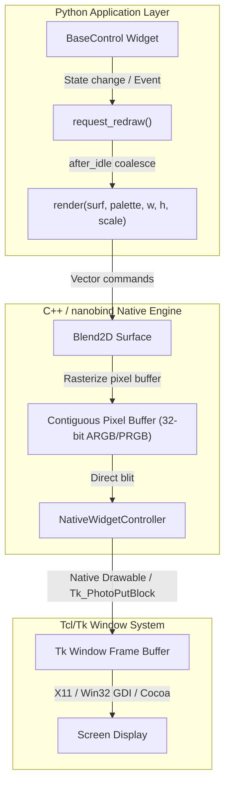
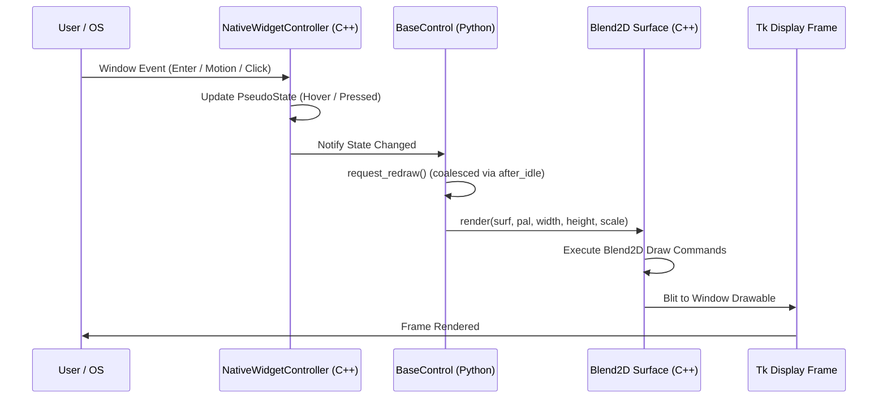
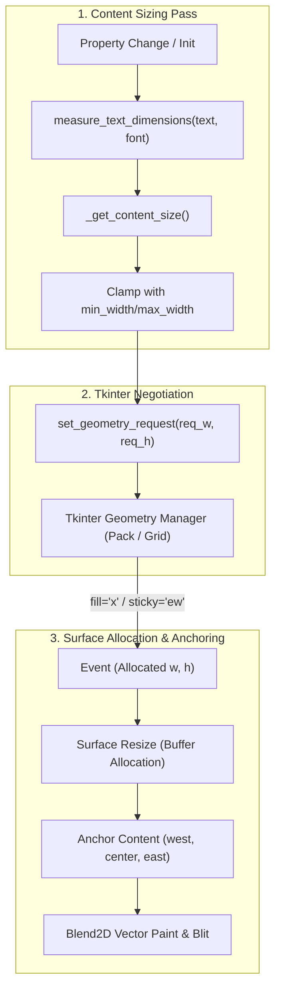
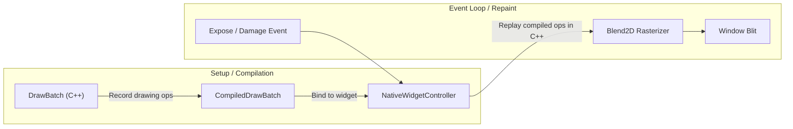

# Architecture & Rendering Pipeline

**tkblend** connects standard Python Tkinter with **Blend2D**, a 2D vector graphics library written in C++ that uses JIT-compiled SIMD pipelines (via AsmJit) for rasterization.

This document describes the rendering architecture, memory lifecycle, C++ blitting pipeline, GIL interaction, and event handling that tkblend uses to draw vector interfaces in Tkinter without relying on TTK themes.

---

## Architectural Motivation: Custom Vector Rendering

Standard Tkinter user interfaces typically rely on one of the following approaches:
1. **Core Tk Canvas Shapes**: The built-in Tk canvas rasterizer is simple, lacks subpixel antialiasing for arbitrary geometries, and does not provide built-in multi-stop gradients or soft shadows.
2. **The Tcl/Tk TTK Engine (`ttk.Style`)**: TTK is based on a structured element engine traditionally styled with 9-slice bitmap skins or platform-native controls. Customizing dynamic geometry, complex gradients, or drop shadows within TTK can be restrictive.
3. **Pillow Intermediates**: Rendering UI frames into PIL images and loading them via `ImageTk.PhotoImage` introduces per-frame Python memory allocations, pixel format conversions (e.g. RGBA to photo format), and GIL contention during rendering.

### The tkblend Approach
tkblend renders custom UI elements analytically using Blend2D into C++ memory buffers, blitting directly to native Tk window drawables or through the `Tk_PhotoPutBlock` C-API.



---

## The Buffer Transfer Pipeline

### 1. Direct Buffer Transfer via Native Drawables and `Tk_PhotoPutBlock`
Blend2D renders directly into a contiguous native memory buffer owned by `BLImage`. Rather than converting this buffer into a PIL Image or allocating intermediate byte arrays in Python, tkblend transfers pixel data directly:

* **Direct transfer**: Memory is allocated and owned by `Blend2D::BLImage`, avoiding Python heap allocations during rasterization.
* **Platform backends**:
  * **Linux (X11)**: Uses `XPutImage` to blit the shared memory buffer directly to the window's `XID` drawable.
  * **Windows (Win32)**: Uses `SetDIBitsToDevice` / `BitBlt` to transfer the DIB buffer to the window's device context (`HDC`).
  * **macOS (Cocoa)**: Binds to the underlying `NSView` / `CALayer` surface.
  * **Fallback**: When native drawables are unavailable, tkblend writes directly into Tkinter's internal photo image via `Tk_PhotoPutBlock`.
* **GIL release during rasterization**: Path calculations and rasterization execute in C++ and can release the Python GIL during heavy math operations.

### 2. Transparent Frame Handling
Standard Tkinter `tk.Frame` widgets redraw a solid background rectangle in C whenever an `Expose` or `Configure` event fires (`DisplayFrame` in Tcl/Tk's `tkFrame.c`). If a custom drawing engine paints directly over a frame, Tk's default background redraw can overwrite the vector surface, causing noticeable flicker.

tkblend addresses this during `BaseControl` initialization:
```python
# BaseControl initialization
super().__init__(master=master, background="", **kwargs)
```
When `background=""` (an empty string) is configured:
1. Tk's internal frame struct sets `framePtr->border = NULL`.
2. When `DisplayFrame` executes, Tk checks if `framePtr->border == NULL` and skips drawing the solid background.
3. Blend2D can paint directly into the window drawable without Tk clearing the background first.

---

## Widget Lifecycle & Event Handling

Interactive widgets in tkblend inherit from `BaseControl`, which pairs a `tk.Frame` with a native `NativeWidgetController`.



### Pseudo-State Machine
`NativeWidgetController` tracks interactive states:
* `NORMAL` (`0x00`): Default idle appearance.
* `HOVER` (`0x01`): Cursor is within widget bounds.
* `PRESSED` (`0x02`): Primary mouse button is held down.
* `FOCUSED` (`0x04`): Widget holds keyboard focus.
* `DISABLED` (`0x08`): Widget ignores user inputs.

State changes evaluate whether a redraw is required. Multiple rapid events (such as repeated mouse motion events) are coalesced into a single scheduled redraw using Tkinter's `after_idle` queue.

---

## Geometry Negotiation & Layout System

tkblend bridges Blend2D's pixel buffer rasterization with standard Tkinter geometry managers (`pack`, `grid`, `place`). Rather than requiring hardcoded pixel widths, controls dynamically compute natural dimensions and cooperate with parent layout managers.



### 1. Headless Content Measurement Pass
Before windows are mapped on screen, `BaseControl` determines natural dimensions using `measure_text_dimensions()`. This utilizes a thread-safe singleton 1x1 Blend2D measurement surface that evaluates exact font metrics (ascent, descent, advance) for single and multi-line text without triggering GUI window allocation.

### 2. Constraint Clamping
Computed natural dimensions are passed through `_compute_target_size()`:
* **Auto-Fit**: When `auto_fit=True` (the default if explicit `width` is omitted), the widget sizes to content + padding.
* **Explicit Overrides**: Explicit `width` or `height` sets the base size.
* **Min/Max Boundaries**: Requested dimensions are clamped by `min_width`, `max_width`, `min_height`, and `max_height`.

### 3. Tkinter Geometry Propagation
Dimensions are requested via `set_geometry_request()`:
* Passes logical pixels multiplied by `scale_factor` to the underlying frame.
* Updates Tkinter's requested geometry (`winfo_reqwidth()` and `winfo_reqheight()`).
* Informs `NativeWidgetController::set_geometry_request()`.

### 4. Responsive Expansion and Content Anchoring
When a widget is placed inside a container using `pack(fill="x", expand=True)` or `grid(sticky="ew")`, Tkinter may allocate more space than the requested minimum:
* **Dynamic Surface Sizing**: The `<Configure>` event captures the allocated pixel dimensions and resizes the native Blend2D buffer.
* **Anchor Alignment**: The `anchor` property (`"w"`, `"center"`, `"e"`) positions text, checkmarks, and icons relative to the expanded boundary.
* **No Raster Distortion**: Because rendering is vector-based rather than a stretched bitmap, elements remain sharp and crisp at any stretched dimension.

### 5. Dynamic Content Mutation
When properties like `widget.text`, `widget.font`, or `widget.min_width` mutate at runtime, `_recalculate_natural_size()` re-measures the content and notifies Tkinter if requested dimensions change, automatically triggering layout re-negotiation.

---

## Memory Management & Threading

### 1. Buffer View Locking and Resize Safety
When Python code or an external consumer requests a raw memory buffer via `Surface.acquire_buffer_view()`, a native view reference is tracked:
* Active buffer views increment an `active_buffers_` counter protected by a mutex.
* If a window resize occurs while an external consumer holds an active buffer view, `Surface::resize()` postpones buffer reallocation until views are released.
* This prevents dangling pointers or reading invalid memory regions during asynchronous operations.

### 2. GIL Boundary Management
* **Rasterization**: Vector path evaluations and gradient calculations execute in C++ and release the GIL (`nb::call_guard<nb::gil_scoped_release>()`) so that other Python threads can continue running.
* **Callbacks**: When C++ event hooks dispatch Python callbacks (such as click handlers or slider change notifications), they acquire the GIL using `nb::gil_scoped_acquire`.
* **Tkinter Main Thread Constraint**: Even though rasterization happens in C++, Tkinter's event loop and widget hierarchy management are inherently bound to Python's main thread.

---

## Display List Acceleration (`DrawBatch`)

For scenarios where Python overhead per frame should be reduced, tkblend provides `DrawBatch` and `CompiledDrawBatch`:



* **Compiled Display Lists**: Pre-records drawing commands (rounded rectangles, linear gradients, shadows, text metrics) directly in C++ structures.
* **Register Bank**: Dynamic tokens (such as theme color slots and animated progress values) can be updated in a contiguous register bank and resolved in C++ using FNV-1a hashing.
* **Expose Event Replay**: When windows are uncovered or damaged, `NativeWidgetController` can replay the compiled draw batch directly to refresh the damaged region without re-evaluating Python drawing logic.

---

## High-Performance Native Engines

To eliminate Python bytecode and GIL overhead in complex widgets, tkblend moves repetitive mathematical layouts, hit-testing, and virtualized multi-element rendering directly into C++:

### 1. Dedicated Table Render Engine (`TableRenderEngine`)
Rather than iterating through virtualized rows and columns via Python loops, `Table` submits a `TableRenderSpec` to `TableRenderEngine::render_table()`:
* **GIL-Released Rasterization**: Executes with `nb::call_guard<nb::gil_scoped_release>()`, allowing Python background threads to proceed unblocked during rendering.
* **Direct Blend2D Context Calls**: Header cells, sort arrows, zebra striping, row highlights, cell clipping, and text draws run natively without per-cell nanobind transitions.
* **Native Hit-Testing**: `find_column_divider`, `get_cell_at`, and `get_cell_bounds` execute in C++ with sub-microsecond latency.

### 2. Native Virtual Viewport Controller (`NativeViewportController`)
Scrollable containers (`Table`, `ScrollableFrame`, `VectorScrollbar`) share a unified native viewport engine:
* **Geometry Calculations**: `compute_scrollbar_geometry()` calculates thumb sizes, track length, progress ratios, and scroll clamping.
* **Drag & Jump Math**: `compute_scroll_drag_delta()` and `compute_scroll_jump()` translate pointer input directly to content offsets.
* **Visible Slicing**: `compute_visible_range()` determines first and last visible item indices in constant $O(1)$ time.

### 3. Direct Typography Measurement (`FontManager::measure_text_bounds`)
Widget auto-fitting (`Button`, `Label`, `Badge`, `Tabview`) leverages `measure_text_bounds` in `FontManager`:
* **Zero Dummy Surface Allocations**: Bypasses the need for intermediate 1x1 measurement surfaces.
* **Fast Multiline Layout**: Scans newlines and calculates maximum line advances and total line heights in a single C++ pass.

---

## Architectural Constraints & Trade-offs

1. **Native Compilation Requirement**: tkblend relies on compiled C++ extensions (`nanobind`, `Blend2D`, `AsmJit`). A suitable compiler and development headers for Tcl/Tk are required for installation.
2. **Single-Threaded UI Loop**: All widget state changes, user interactions, and geometry updates must occur on the main Python thread running the Tkinter event loop.
3. **Platform Differences**: Direct drawable blitting depends on OS-level windowing subsystem support (X11 on Linux, GDI on Windows, Cocoa on macOS). Environments without direct drawable handles fall back to `Tk_PhotoPutBlock`.
4. **Text Layout**: Text rendering uses Blend2D's font rendering engine. It handles single-line and basic multi-line layout well, but does not include full complex text shaping engines (such as HarfBuzz) for complex scripts or bidirectional text.

> [!TIP]
> For in-depth technical analysis, concrete symptoms, and code workarounds for platform blitting, Wayland unmapped window IDs, thread safety, and buffer view locks, see the [Caveats, Edge Cases & Troubleshooting Guide](caveats_and_edge_cases.md).

